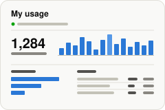

<p align="center">
  
</p>

# My usage

<p align="center">
  <a href="https://studio.imbue.com/open?git_url=https://github.com/boweiliu/my-usage-template"></a>
</p>

Didn't work? Create a Studio workspace and paste this to your agent:
` /use-template https://github.com/boweiliu/my-usage-template`

## Why you care

Imbue's analytics collects usage data from explorer-plan Studio workspaces, but
the person whose usage it is never gets to see it, and local workspaces are
never visited at all. This gives you your own copy of exactly that data, kept
on your workspace, and a page that turns it into numbers you can read: how much
you talk to your agents, how much work they do, on which models, in which
chats.

**Who it works for today:** the collection script is downloaded from Imbue's
private `imbue-ai/mngr-internal` repo, so it only works when your workspace's
GitHub sign-in can read that repo (Imbue staff). Without it, the page installs
and shows its empty state.

## How to use it

After adopting, your agent walks through setup (the full steps, each with the
check that proves it worked, are in
[`system/apps/my_usage/docs/RUNBOOK-setup.md`](system/apps/my_usage/docs/RUNBOOK-setup.md)):
confirm GitHub can read the repo, download the collection script, run the first
collection in the background, add an hourly routine, then open the page.

**The page** (the **My usage** window):

- A strip under the title says when your copy was last collected, how many
  collections and records it holds, and whether any collection failed.
- **Last 7 days / Last 30 days / All** and a **Model** filter scope every number
  below them.
- **Messages you sent per day** and **Agent steps per day**, each with a
  **Table** toggle that shows the same numbers as a table; hover a column for
  its value.
- **Agent steps by model** and **Apps** (the apps installed in the workspace).
- **Chats**: every chat with its harness, messages, agent steps and last
  activity, sortable. **View raw** opens the original collected records for
  that chat, pretty-printed, with the file they came from.

**The copy**, if you want to drive it yourself:

```bash
python3 .agents/skills/local-analytics-copy/scripts/local_analytics_copy.py status  # collector version, newer one on main?, recent runs, disk use
python3 .agents/skills/local-analytics-copy/scripts/local_analytics_copy.py run     # one collection now
python3 .agents/skills/local-analytics-copy/scripts/local_analytics_copy.py fetch   # take a newer collection script, on purpose
```

Or just ask your agent: "refresh my usage copy", "is there a newer collector?",
"what did the last collection pick up?". Each run's output is kept byte for byte
under `data/.skills/local-analytics-copy/runs/`; nothing is deleted.

**What it cannot show yet:** opens and request counts per app need
default-workspace-template PR #1061 (merged 2026-11-04, in no release at that
date), so until your workspace has it the Apps panel lists installed apps and
says so. Error reports (Sentry) are a different stream and are not covered.
Adopting this into a fresh workspace has not been tried yet.

## Ideas for making it yours

- Add a weekly summary: a routine that reads the same copy every Monday and
  posts last week's messages, steps and busiest chats to you.
- Chart a source the page does not use yet: the copy already holds
  `git_numstat` (lines changed) and `services` records, so a "code written per
  day" panel is one more reader in `usage_data.py`.
- Split agent steps by hour of day to see when you actually work with your
  agents.
- Run it less often: change the routine from hourly to daily if you only look
  at the page once a week.
- Compare two periods side by side ("this month vs last month") with a second
  date-range filter.

## What this is

This repository is a published **Imbue Studio template**: a clean, bootable
snapshot of what an agent built, ready to adapt into your own. It is NOT the
generic workspace template -- it is this specific project.

[`template.md`](template.md) is the full manifest -- what it is, how it
works, what it needs to run, and what to adapt -- with the
machine-readable half (recipe, requirements, and the environment it needs
installed) in [`template.toml`](template.toml).
